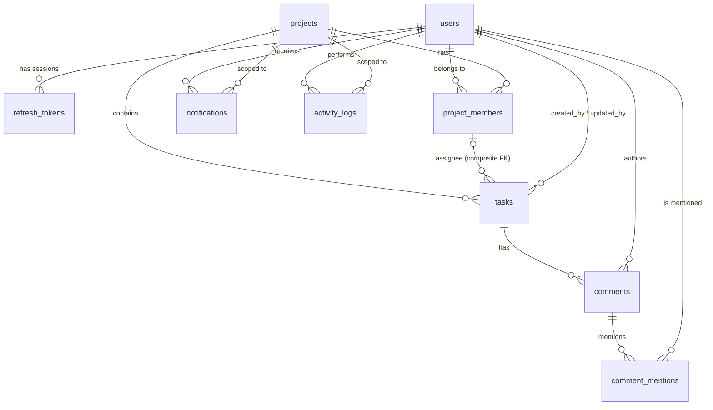

# Data Model: Collaborative Project Management Platform

PostgreSQL **15+** (one rule in §3.5 depends on a PG15 feature). This schema backs the REST + SSE contract in [API_DESIGN.md](API_DESIGN.md).

---

## 1. Design Principles

| Principle | Why |
|---|---|
| **Never lose history.** Users are deactivated, not deleted. Activity and notifications store a snapshot of names/titles in `metadata` | Activity must still make sense after a task is renamed or deleted, or a user is deactivated |
| **Enforce invariants in the DB where possible**, in app code otherwise | A forgotten app check shouldn't be able to corrupt data (duplicate members, assignee outside the project) |
| **Roles are fixed enums (`CHECK`), not a `roles` table** | The role set is fixed by the spec and permissions live in code (the policy layer). A roles table would add joins and give nothing back |
| **Optimistic locking via `version`** on `tasks` and `projects` | Required by spec §7. Cheap and lock-free for reads |
| **UUID primary keys** (`gen_random_uuid()`) | Safe to expose in URLs, can't be enumerated, can be generated anywhere |
| **`timestamptz` everywhere, stored in UTC**. `due_date` is a plain `date` | A due date is a calendar day, not an instant |
| **Every multi-step write runs in one transaction** (change + activity + notifications), and SSE events go out after commit | Nobody sees a half-applied change. No phantom events from a rolled-back write |

---

## 2. Entity Relationship Diagram



---

## 3. Tables

### 3.1 `users`

```sql
CREATE TABLE users (
  id               uuid PRIMARY KEY DEFAULT gen_random_uuid(),
  name             varchar(100) NOT NULL CHECK (length(trim(name)) > 0),
  email            varchar(255) NOT NULL,                -- stored lower-cased + trimmed by the app
  password_hash    text NOT NULL,                        -- bcrypt/argon2, never returned by the API
  role             varchar(20) NOT NULL
                   CHECK (role IN ('ADMIN','PROJECT_MANAGER','TEAM_MEMBER','VIEWER')),
  is_active        boolean NOT NULL DEFAULT true,
  avatar_url       text,
  last_login_at    timestamptz,
  deactivated_at   timestamptz,
  deactivated_by   uuid REFERENCES users(id),
  created_at       timestamptz NOT NULL DEFAULT now(),
  updated_at       timestamptz NOT NULL DEFAULT now(),
  CHECK (is_active OR deactivated_at IS NOT NULL)
);
CREATE UNIQUE INDEX users_email_lower_uq ON users (lower(email));   -- case-insensitive uniqueness
CREATE INDEX users_active_role_idx ON users (is_active, role);
```

### 3.2 `refresh_tokens`

```sql
CREATE TABLE refresh_tokens (
  id           uuid PRIMARY KEY DEFAULT gen_random_uuid(),
  user_id      uuid NOT NULL REFERENCES users(id) ON DELETE CASCADE,
  token_hash   char(64) NOT NULL UNIQUE,     -- SHA-256 of the token; the raw token is never stored
  family_id    uuid NOT NULL,                -- all rotations of one login share a family
  expires_at   timestamptz NOT NULL,
  revoked_at   timestamptz,
  replaced_by  uuid REFERENCES refresh_tokens(id),
  user_agent   text,
  created_at   timestamptz NOT NULL DEFAULT now()
);
CREATE INDEX refresh_tokens_user_idx ON refresh_tokens (user_id) WHERE revoked_at IS NULL;
CREATE INDEX refresh_tokens_family_idx ON refresh_tokens (family_id);
```

**Rotation with reuse detection:** each `/auth/refresh` revokes the current token and issues a new one in the same family. If an **already-revoked** token is presented, the token was stolen and reused, so the **whole family** is revoked and that session is logged out.

### 3.3 `projects`

```sql
CREATE TABLE projects (
  id           uuid PRIMARY KEY DEFAULT gen_random_uuid(),
  name         varchar(120) NOT NULL CHECK (length(trim(name)) > 0),
  description  text CHECK (length(description) <= 5000),
  status       varchar(10) NOT NULL DEFAULT 'ACTIVE' CHECK (status IN ('ACTIVE','ARCHIVED')),
  version      integer NOT NULL DEFAULT 1 CHECK (version >= 1),
  created_by   uuid NOT NULL REFERENCES users(id),
  archived_at  timestamptz,
  archived_by  uuid REFERENCES users(id),
  created_at   timestamptz NOT NULL DEFAULT now(),
  updated_at   timestamptz NOT NULL DEFAULT now(),
  CHECK ((status = 'ARCHIVED') = (archived_at IS NOT NULL))
);
-- Two ACTIVE projects can't share a name. Archived names may be reused.
CREATE UNIQUE INDEX projects_active_name_uq ON projects (lower(name)) WHERE status = 'ACTIVE';
CREATE INDEX projects_status_updated_idx ON projects (status, updated_at DESC);
```

### 3.4 `project_members`

```sql
CREATE TABLE project_members (
  project_id  uuid NOT NULL REFERENCES projects(id) ON DELETE CASCADE,
  user_id     uuid NOT NULL REFERENCES users(id),
  role        varchar(10) NOT NULL CHECK (role IN ('MANAGER','MEMBER','VIEWER')),
  added_by    uuid NOT NULL REFERENCES users(id),
  created_at  timestamptz NOT NULL DEFAULT now(),
  updated_at  timestamptz NOT NULL DEFAULT now(),
  PRIMARY KEY (project_id, user_id)              -- one membership per user per project
);
CREATE INDEX project_members_user_idx ON project_members (user_id);   -- "my projects"
```

The role ceiling (system role → maximum project role, see API §2) is checked in the app, because it needs a join to `users`.

### 3.5 `tasks`

```sql
CREATE TABLE tasks (
  id            uuid PRIMARY KEY DEFAULT gen_random_uuid(),
  project_id    uuid NOT NULL REFERENCES projects(id) ON DELETE CASCADE,
  title         varchar(200) NOT NULL CHECK (length(trim(title)) > 0),
  description   text CHECK (length(description) <= 10000),
  status        varchar(12) NOT NULL DEFAULT 'TODO'
                CHECK (status IN ('TODO','IN_PROGRESS','IN_REVIEW','DONE')),
  priority      varchar(8) NOT NULL DEFAULT 'MEDIUM'
                CHECK (priority IN ('LOW','MEDIUM','HIGH','URGENT')),
  assignee_id   uuid,
  due_date      date,
  completed_at  timestamptz,
  version       integer NOT NULL DEFAULT 1 CHECK (version >= 1),
  created_by    uuid NOT NULL REFERENCES users(id),
  updated_by    uuid NOT NULL REFERENCES users(id),
  created_at    timestamptz NOT NULL DEFAULT now(),
  updated_at    timestamptz NOT NULL DEFAULT now(),

  -- The assignee MUST be a member of the SAME project. If the membership row is deleted,
  -- only assignee_id is nulled (PG15 column-list syntax), and project_id is left alone.
  FOREIGN KEY (project_id, assignee_id)
    REFERENCES project_members (project_id, user_id)
    ON DELETE SET NULL (assignee_id),

  CHECK ((status = 'DONE') = (completed_at IS NOT NULL))
);
CREATE INDEX tasks_project_status_idx   ON tasks (project_id, status, updated_at DESC);
CREATE INDEX tasks_assignee_status_idx  ON tasks (assignee_id, status) WHERE assignee_id IS NOT NULL;
CREATE INDEX tasks_project_due_idx      ON tasks (project_id, due_date) WHERE status <> 'DONE';
CREATE INDEX tasks_title_search_idx     ON tasks USING gin (to_tsvector('simple', title));
```

`project_id` can never be changed (moving tasks between projects isn't supported), so the composite FK always stays valid.

**Overdue** is computed, not stored: `due_date < CURRENT_DATE AND status <> 'DONE'`. "Today" is the server's UTC date. This simplification is documented in the README.

### 3.6 `comments` and `comment_mentions`

```sql
CREATE TABLE comments (
  id          uuid PRIMARY KEY DEFAULT gen_random_uuid(),
  task_id     uuid NOT NULL REFERENCES tasks(id) ON DELETE CASCADE,
  project_id  uuid NOT NULL REFERENCES projects(id) ON DELETE CASCADE,  -- denormalized for authz + feeds
  author_id   uuid NOT NULL REFERENCES users(id),
  body        text NOT NULL CHECK (length(trim(body)) BETWEEN 1 AND 5000),
  created_at  timestamptz NOT NULL DEFAULT now()
);
CREATE INDEX comments_task_created_idx ON comments (task_id, created_at);

CREATE TABLE comment_mentions (
  comment_id  uuid NOT NULL REFERENCES comments(id) ON DELETE CASCADE,
  user_id     uuid NOT NULL REFERENCES users(id),
  PRIMARY KEY (comment_id, user_id)               -- the same person mentioned twice = one row
);
```

**Mention format:** the UI's `@` picker inserts the token `@[Asha Rao](<userId>)` into the body. The server extracts the uuids, **dedupes** them and keeps only **active current project members** (any role, since every member can read the task). The author mentioning themself is dropped. Invalid ids are silently ignored and the token renders as plain text. Matching on ids instead of `@name` avoids ambiguity when two people share a name.

The `comments.project_id` value is set by the server from the task (never from the client), and the app checks that it matches the task's project.

### 3.7 `notifications`

```sql
CREATE TABLE notifications (
  id            uuid PRIMARY KEY DEFAULT gen_random_uuid(),
  recipient_id  uuid NOT NULL REFERENCES users(id),
  actor_id      uuid REFERENCES users(id),               -- NULL = system
  type          varchar(30) NOT NULL CHECK (type IN (
                  'TASK_ASSIGNED','TASK_UNASSIGNED','TASK_STATUS_CHANGED','TASK_UPDATED',
                  'COMMENT_ADDED','MENTIONED',
                  'PROJECT_MEMBER_ADDED','PROJECT_MEMBER_REMOVED','PROJECT_ROLE_CHANGED')),
  project_id    uuid REFERENCES projects(id) ON DELETE CASCADE,
  entity_type   varchar(20) NOT NULL CHECK (entity_type IN ('PROJECT','TASK','COMMENT')),
  entity_id     uuid NOT NULL,                           -- polymorphic, no FK (the entity may be deleted later)
  metadata      jsonb NOT NULL DEFAULT '{}',             -- snapshot: taskTitle, projectName, actorName, from/to...
  read_at       timestamptz,                             -- NULL = unread
  created_at    timestamptz NOT NULL DEFAULT now(),
  CHECK (actor_id IS NULL OR actor_id <> recipient_id)   -- never notify yourself
);
CREATE INDEX notifications_recipient_created_idx ON notifications (recipient_id, created_at DESC);
CREATE INDEX notifications_unread_idx ON notifications (recipient_id) WHERE read_at IS NULL;   -- fast badge count
```

`read_at` is used instead of a boolean, which also records when something was read. The API exposes it as `isRead`. The message text is **rendered from `type` + `metadata` when the API returns it**, not stored, so wording can change without a data migration.

### 3.8 `activity_logs`

```sql
CREATE TABLE activity_logs (
  id           uuid PRIMARY KEY DEFAULT gen_random_uuid(),
  user_id      uuid REFERENCES users(id),                -- actor; NULL = system/seed
  project_id   uuid REFERENCES projects(id) ON DELETE CASCADE,  -- NULL = system-level event
  action       varchar(30) NOT NULL,                     -- CHECK against the catalogue in API §4.8
  entity_type  varchar(20) NOT NULL CHECK (entity_type IN ('USER','PROJECT','MEMBER','TASK','COMMENT')),
  entity_id    uuid NOT NULL,
  metadata     jsonb NOT NULL DEFAULT '{}',
  created_at   timestamptz NOT NULL DEFAULT now()
);
CREATE INDEX activity_project_created_idx ON activity_logs (project_id, created_at DESC);
CREATE INDEX activity_entity_idx          ON activity_logs (entity_type, entity_id, created_at DESC);
CREATE INDEX activity_created_idx         ON activity_logs (created_at DESC);   -- admin system feed
```

These are exactly the fields suggested in spec §8. The table is **append-only**: the app has no UPDATE/DELETE path, and the DB role used by the app can be granted only `INSERT, SELECT` on it.

**Deleting a project** cascades its project-scoped logs. The `PROJECT_DELETED` entry is written with `project_id = NULL` and `metadata = { projectId, projectName, taskCount, memberCount }`, so the admin system feed keeps a permanent record.

**`metadata` examples:**

| Action | metadata |
|---|---|
| `TASK_STATUS_CHANGED` | `{ "taskTitle": "...", "from": "TODO", "to": "IN_PROGRESS" }` |
| `TASK_ASSIGNED` | `{ "taskTitle": "...", "assigneeId": "...", "assigneeName": "...", "previousAssigneeId": null }` |
| `TASK_UPDATED` | `{ "taskTitle": "...", "changes": { "priority": ["LOW","HIGH"], "dueDate": [null,"2026-10-20"] } }` |
| `MEMBER_REMOVED` | `{ "userName": "...", "role": "MEMBER", "unassignedTaskIds": ["..."] }` |
| `COMMENT_ADDED` | `{ "taskId": "...", "taskTitle": "...", "excerpt": "first 120 chars" }` |

### 3.9 Not stored in the DB

| Item | Where | Why |
|---|---|---|
| SSE tickets | In memory, 30 s TTL, deleted on first use | Short-lived; a restart just means the client asks for a new one |
| SSE replay buffer (last ~1,000 events) | In memory | On overflow or restart the client gets `resync` and refetches from REST |
| Access tokens | Not stored (stateless JWT) | `is_active` is checked on every request, so revocation is immediate anyway |

---

## 4. Edge Cases & How the Model Handles Them

### 4.1 Users & Auth

| # | Scenario | Handling |
|---|---|---|
| U1 | Same email with different case (`Asha@x.com` vs `asha@x.com`) | Unique index on `lower(email)`. App also lower-cases and trims → 409 `EMAIL_TAKEN` |
| U2 | Unknown email vs wrong password | Same `401 INVALID_CREDENTIALS` and similar response time (always run the hash compare) so nobody can find out which emails exist |
| U3 | Deactivated user tries to log in | 401 `ACCOUNT_DEACTIVATED` |
| U4 | User deactivated while logged in | Middleware checks `is_active` on every request → 401. All refresh tokens revoked. `session.revoked` sent and SSE stream closed |
| U5 | Admin deactivates or demotes **themselves** | 400 `CANNOT_MODIFY_SELF` |
| U6 | Deactivating/demoting the **last active Admin** | 409 `LAST_ADMIN`. The check runs in the same transaction with the admin rows locked (`SELECT ... FOR UPDATE`), so two admins demoting each other at the same time can't both succeed |
| U7 | Deactivated user is still a project member / task assignee | Memberships and assignments are **kept** (history intact, restored on reactivation). UI shows a "deactivated" badge. They can't be **newly** assigned or added (400 `USER_INACTIVE`) and get no notifications |
| U8 | System role downgraded (e.g. PM → TEAM_MEMBER) | In the same transaction, any project role above the new ceiling is lowered (MANAGER → MEMBER). Downgrade to VIEWER → all memberships become VIEWER **and their tasks are unassigned** (see M5). Each change is logged + notified |
| U9 | Refresh token stolen and reused | Rotation family reuse detection → whole family revoked (§3.2) |
| U10 | Password change | All **other** refresh tokens of that user are revoked |
| U11 | Mention / notification / activity for a deactivated actor | `user_id` FK still valid (users never deleted). UI shows the name with a "deactivated" badge |

### 4.2 Projects

| # | Scenario | Handling |
|---|---|---|
| P1 | Two active projects with the same name | Partial unique index → 409 `PROJECT_NAME_TAKEN` |
| P2 | Unarchiving when an active project now has the same name | Same index fires → 409 `PROJECT_NAME_TAKEN`. The Admin renames one first |
| P3 | Archive while someone is editing a task in that project | Archive takes `SELECT ... FOR UPDATE` on the project row. Every task/comment/member write takes `FOR SHARE` on it and checks `status = 'ACTIVE'`. Whichever runs second sees the final state, so no writes slip into an archived project |
| P4 | Archive/unarchive twice | 409 `ALREADY_ARCHIVED` / `NOT_ARCHIVED` |
| P5 | Project with **zero** managers | Allowed (Admin can create without managers, or remove the last one). Admin still manages it. The dashboard flags "No manager assigned" |
| P6 | Project deleted while users are viewing it | Cascade removes tasks, comments, mentions, members, notifications, project activity. `project.deleted` is sent to the (pre-delete) member list, and clients redirect to `/projects` with a toast |
| P7 | Concurrent edits of project name/description | `projects.version` → 409 like tasks |
| P8 | Admin is not a member of a project | Admin gets full access without a membership row. `myRole` returns `ADMIN`. To be **assigned tasks**, an Admin must be added as MEMBER/MANAGER (the composite FK requires it) |

### 4.3 Project Members

| # | Scenario | Handling |
|---|---|---|
| M1 | Add the same user twice (including two concurrent requests) | PK `(project_id, user_id)` → 409 `ALREADY_MEMBER` |
| M2 | Add a deactivated user | 400 `USER_INACTIVE` |
| M3 | Project role above the user's system-role ceiling | 400 `ROLE_EXCEEDS_SYSTEM_ROLE` |
| M4 | Manager adds/promotes/demotes/removes a MANAGER (including themselves) | 403. Only an Admin touches MANAGER rows |
| M5 | Member removed, or changed to VIEWER, while they have assigned tasks | In one transaction: unassign their tasks **and bump each task's `version`** (so anyone editing with the old version gets 409 instead of overwriting). Log `MEMBER_REMOVED`/`MEMBER_ROLE_CHANGED` with `unassignedTaskIds`, notify the user, send `task.updated` for each task. The FK `ON DELETE SET NULL (assignee_id)` is a safety net only, because the app does this explicitly so it can log and notify |
| M6 | Removed member still has the project open | Recipients are computed at send time, so they get no more project events, and their next REST call gets 404. They receive `member.removed` on their user stream and the UI redirects |
| M7 | Removed member's old comments | Kept, still authored by them. They can no longer delete them (no access); the Manager/Admin can |
| M8 | Removed member clicks an old notification | 404 → UI shows "You no longer have access to this project" |

### 4.4 Tasks

| # | Scenario | Handling |
|---|---|---|
| T1 | Stale update (spec example: v7 vs v8) | `UPDATE ... WHERE id = $1 AND version = $2` returns 0 rows → re-read → 409 `VERSION_CONFLICT` with the current task |
| T2 | Update or delete a task someone else just **deleted** | 0 rows + re-read finds nothing → 404 `TASK_DELETED`. The open detail page already received `task.deleted` and shows a banner |
| T3 | Two people change **different** fields at the same time (Manager edits title, Member edits description) | Whole-row version, so the second gets 409. This is deliberate: simple and never silently wrong. The conflict dialog shows exactly which fields changed |
| T4 | No-op update (status set to its current value, same assignee) | Version still checked first (stale → 409). If nothing actually changes → 200 with the unchanged task: **no version bump, no activity, no notification, no event** |
| T5 | Assign to a non-member, a VIEWER, a member of another project, or a deactivated user | Composite FK rejects non-members/other projects. The app rejects VIEWER and inactive users → 400 `INVALID_ASSIGNEE` |
| T6 | Member tries to change a task not assigned to them, or a field outside `description`/`status` | 403. Checked against the **current DB row**, not the client's copy |
| T7 | Task is reassigned away from a Member while they're editing it | Reassignment bumps the version → their submit gets 409. On re-check they're no longer the assignee → 403 |
| T8 | Moving to/from `DONE` | `completed_at` set when entering DONE, cleared when leaving (DB `CHECK` enforces it). Any status → any status is allowed (Kanban) |
| T9 | Due date in the past on create/update | Allowed (backfilling real work). It just shows as overdue |
| T10 | Creating a task with an assignee | One transaction: `TASK_CREATED` + `TASK_ASSIGNED` activity, `TASK_ASSIGNED` notification (unless self-assigned), `task.created` event |
| T11 | Deleting a task | Comments and mentions cascade. Notifications/activity referencing it stay (polymorphic id + title snapshot) and the link shows "Task was deleted" |
| T12 | Whitespace-only title/comment | App trims, and the DB `CHECK (length(trim(...)) > 0)` backs it up → 400 |
| T13 | Version overflow | `integer` gives ~2.1 billion edits per task. Not a real concern |

### 4.5 Comments & Mentions

| # | Scenario | Handling |
|---|---|---|
| C1 | Mention a non-member, a deactivated user, yourself, or the same person twice | Filtered/deduped server-side (§3.6). Only valid mentions get rows + notifications |
| C2 | User is both mentioned **and** the assignee | Gets **one** `MENTIONED` notification, not also `COMMENT_ADDED` |
| C3 | Comment on a task in an archived project | 403 `PROJECT_ARCHIVED` |
| C4 | Comment deleted after mention notifications went out | Notifications stay (they point to the task, with an excerpt in metadata). The comment is just gone from the thread. `COMMENT_DELETED` is logged with the excerpt |
| C5 | Comment posted on a task that was deleted a moment before | The FK on `task_id` fails → 404 `TASK_DELETED` |
| C6 | Viewer tries to comment | 403 (viewers are read-only) |

### 4.6 Notifications

| # | Scenario | Handling |
|---|---|---|
| N1 | Actor would notify themselves | Skipped in the app, and the DB `CHECK (actor_id <> recipient_id)` backs it up |
| N2 | One action affects the same person through several roles (creator + assignee + previous commenter) | Recipient set is **deduped** per action, with priority MENTIONED > TASK_ASSIGNED > others |
| N3 | "Mark all read" while new notifications are arriving | `UPDATE ... SET read_at = now() WHERE recipient_id = $1 AND read_at IS NULL AND created_at <= $2`, where `$2` is the time the client loaded the list (sent in the request). Newer ones stay unread |
| N4 | Reading another user's notification by id | `WHERE id = $1 AND recipient_id = $me` → 404 |
| N5 | Badge out of sync across tabs | `notification.read` event carries the new `unreadCount` |
| N6 | Recipient deactivated | No new notifications are created for inactive users |

### 4.7 Transactions & Real-Time

| # | Scenario | Handling |
|---|---|---|
| R1 | Write succeeds but the event publish fails or the server crashes right after commit | Data is correct. Clients recover on reconnect (`resync` → refetch). A transactional outbox would be needed for guaranteed delivery, but that's out of scope for one instance (documented trade-off) |
| R2 | Transaction rolls back | Events are queued on the transaction context and only published **after commit**, so no phantom events |
| R3 | Activity log insert fails | It's in the same transaction, so the whole action fails. There are never untracked changes |
| R4 | Deadlocks between project lock (P3) and task updates | Always lock in the same order: project row (`FOR SHARE`/`FOR UPDATE`) → task row |

---

## 5. Key Write Paths (transaction outlines)

**Change task status** (`PATCH /tasks/:id/status`)
1. `BEGIN`
2. `SELECT status FROM projects WHERE id = $pid FOR SHARE`. If archived → 403.
3. Load the task. Run the policy check (Manager/Admin, or Member who is the assignee) → 403 / 404.
4. If the version matches and the status is unchanged → `COMMIT`, return 200 (T4).
5. `UPDATE tasks SET status = $s, completed_at = ..., version = version + 1, updated_by = $me, updated_at = now() WHERE id = $id AND version = $v RETURNING *`. If 0 rows → 409 / 404.
6. `INSERT activity_logs` (`TASK_STATUS_CHANGED`, from/to).
7. `INSERT notifications` for assignee + creator, deduped, without the actor.
8. `COMMIT` → publish `task.updated`, `activity.created`, `notification.created`.

**Remove project member**
1. `BEGIN`, lock the project row `FOR SHARE`. Policy check (Manager can't remove a MANAGER).
2. `UPDATE tasks SET assignee_id = NULL, version = version + 1 ... WHERE project_id = $p AND assignee_id = $u RETURNING id, title`.
3. `DELETE FROM project_members WHERE project_id = $p AND user_id = $u`. If 0 rows → 404.
4. Activity: `MEMBER_REMOVED` (with `unassignedTaskIds`) + `TASK_UNASSIGNED` per task. Notification to the removed user.
5. `COMMIT` → invalidate the membership cache → publish `member.removed` + `task.updated` (one per task).

---

## 6. Migrations & Seed Data

- Migrations are versioned SQL files, run with one documented command, and can rebuild the schema from an empty DB. `pgcrypto` is enabled for `gen_random_uuid()` (built into PG13+).
- **Seed** (idempotent: it truncates and re-inserts). All passwords are `Password123!`:

| User | System role | Memberships |
|---|---|---|
| admin@demo.com | ADMIN | – (access to everything) |
| pm@demo.com | PROJECT_MANAGER | MANAGER of "Website Revamp" + "Mobile App" |
| alice@demo.com / bob@demo.com | TEAM_MEMBER | MEMBER of "Website Revamp", Bob also in "Mobile App" |
| viewer@demo.com | VIEWER | VIEWER of "Website Revamp" |
| inactive@demo.com | TEAM_MEMBER (deactivated) | Shows the deactivated-user cases |

- Projects: 2 active, plus 1 archived ("Legacy CRM", to show read-only behaviour).
- About 15 tasks across all statuses and priorities. At least one overdue, one unassigned, one DONE.
- Comments including an `@mention`, matching notifications (some read, some unread), and activity history generated through the same service functions as the real API, so the seeded data looks exactly like real data.
